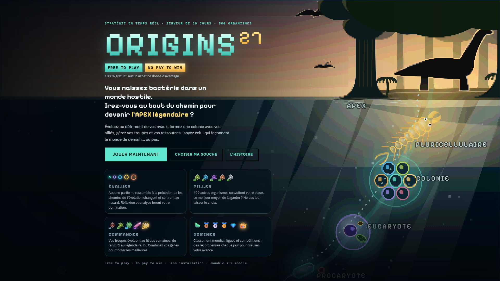
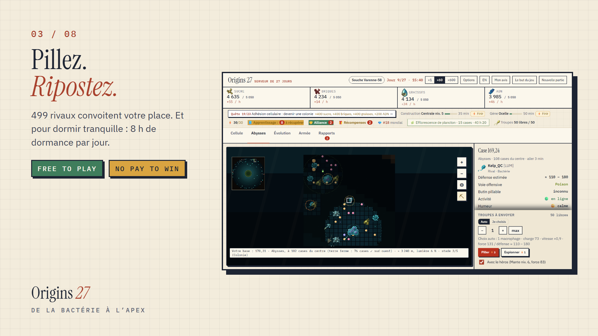
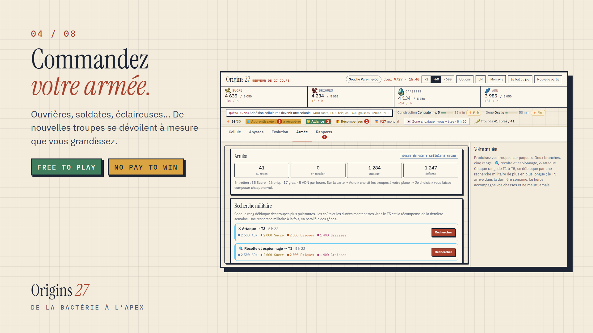

# Origins 27

**Vous naissez bactérie dans un monde hostile. Irez-vous au bout du chemin pour devenir l’APEX légendaire ?**

### ▶ [Jouer maintenant : shakeitout-teach.github.io/origins-27](https://shakeitout-teach.github.io/origins-27/)

**FREE TO PLAY · NO PAY TO WIN** : le jeu est entièrement gratuit, et aucun achat ne donne d’avantage.

Évoluez au détriment de vos rivaux, formez une colonie avec vos alliés, gérez vos troupes et vos ressources : soyez celui qui façonnera le monde de demain… ou pas. Origins 27 est un jeu de stratégie en temps réel, jouable dans le navigateur, sur un serveur de 30 jours peuplé de 500 organismes.

- **Évoluez :** aucune partie ne ressemble à la précédente. Les chemins de l’évolution changent et se tirent au hasard ; réflexion et analyse feront votre domination.
- **Pillez :** 499 autres organismes convoitent votre place. Le meilleur moyen de la garder ? Ne pas leur laisser le choix.
- **Commandez :** vos troupes évoluent au fil des semaines, du rang T1 au légendaire T5. Combinez vos gènes pour forger les meilleures.
- **Dominez :** classement mondial, ligues et compétitions : des récompenses chaque jour pour creuser votre avance.

Le jeu est écrit en HTML, CSS et JavaScript, sans dépendance à installer ni étape de compilation : il suffit d’ouvrir `index.html` dans un navigateur.



## Présentation

- **Bande-annonce (28 s, 1080p) :** [presentation/origins27-bande-annonce.webm](presentation/origins27-bande-annonce.webm)
- **Images légendées :** [paysage 1920 × 1080](presentation/paysage-1920x1080) et [mobile 1080 × 1920](presentation/mobile-1080x1920), plus l’[image clé sans texte](presentation/image-cle-sans-texte.png).

| | |
|---|---|
|  |  |
|  |  |

## Jouer

- **En ligne :** https://shakeitout-teach.github.io/origins-27/ (GitHub Pages, mis à jour automatiquement à chaque modification de la branche `main`).
- **En local :** double-cliquez sur `index.html`.
- **Sur votre propre copie du dépôt :** *Settings → Pages → Branch : `main` / `(root)` → Save*. Le jeu est ensuite servi à `https://<votre-compte>.github.io/<nom-du-depot>/`.

La partie est sauvegardée dans le navigateur (localStorage), sur l’appareil utilisé.

## Avis des joueurs

Le bouton **Mon avis** (✉ sur mobile), en haut de l’écran et en bas de l’écran d’accueil, ouvre une fenêtre de 3 questions et une note sur 5. Le joueur peut :

- **Envoyer sur GitHub :** une page « New issue » s’ouvre déjà remplie, avec en plus le jour, le stade, la souche et l’appareil. Les avis arrivent dans l’onglet [Issues](https://github.com/ShakeItOut-teach/origins-27/issues) du dépôt. Il faut un compte GitHub gratuit.
- **Copier le texte :** pour l’envoyer par message, sans compte.

Le texte tapé est gardé si la fenêtre est fermée. Un seul rappel discret apparaît au jour 2 de la partie.

**Compteur de visites (facultatif) :** créez un compte gratuit sur [goatcounter.com](https://www.goatcounter.com), puis collez son adresse dans `STATS_URL`, en haut de `js/22-avis.js` (par exemple `https://origins27.goatcounter.com/count`). Le comptage est anonyme, sans cookie, et ne fonctionne que sur le site en ligne.

## Contenu détaillé

- **Écran d’accueil :** image animée de l’ascension (procaryote, eucaryote, colonie, pluricellulaire, APEX sortant de l’eau), accroche, « Jouer maintenant » en un clic, et l’histoire en 7 étapes pour qui veut lire.
- **Cellule :** 4 canaux de production (ATP, protéines, lipides, nucléotides) ; chaque canal coûte peu de la ressource qu’il produit et 8 emplacements d’organites autour du noyau.
- **Armée en rangs T1 à T5 :** deux branches, 🔍 récolte et espionnage (collectrice → éclaireuse et porteuse → diatomée de verre → siphonophore → cténophore spectral) et ⚔ attaque (soldate → une troupe par voie offensive → Volvox gardien → Ver segmenté → Anomalocaride). Chaque rang se débloque par une recherche militaire aux coûts et durées exponentiels (2 h, 8 h, 24 h, 48 h de jeu) : T2 vers le jour 3, T3 vers le jour 10, T4 vers le jour 18, T5 dans la dernière semaine. Plus le rang est haut, plus l’icône de la troupe est aboutie : membrane simple, organites, armure, colonie, puis forme légendaire dorée et animée.
- **Espionnage :** les troupes de la branche récolte et espionnage peuvent espionner un rival (⚡1). Réussite selon la force d’espionnage contre sa vigilance ; un succès affiche ses chiffres exacts pendant 24 h, un échec coûte la moitié des espionnes.
- **Production :** les ribosomes fabriquent toutes les troupes, avec une chaîne de production de plus aux niveaux 3, 6 et 9 ; la production se lance aussi depuis le noyau.
- **Envois :** mode « Auto » ou « Je choisis » pour composer soi-même chaque chasse, pillage ou récolte.
- **Rapports :** tableau de force par type de troupe (voie, bonus, pertes), raison de la victoire ou de la défaite, détail du butin et des ressources volées, bilan cumulé des pillages.
- **Énergie (⚡) :** chaque action en consomme (récolter ou explorer 1, chasser 2, piller 3, accélérer un chantier ou un gène de 1 h : 5). Elle remonte de 1 toutes les 20 minutes jusqu’à 30. Seules les récompenses la font dépasser 30 (jusqu’à 120) : connexion du jour, coffres, quêtes du jour, ligue, léviathan vaincu et gisements d’événement (gratuits à récolter, +2 au retour).
- **Récompenses (🎁) :** série de connexion sur 7 jours, coffre gratuit toutes les 4 heures, 3 quêtes du jour. Les coffres ont 4 raretés : commun ×1 (70 %), rare ×2 (20 %), très rare ×4 (8 %), extrêmement rare ×8 (2 %). L’ouverture est animée : le coffre tombe, monte en rareté sous vos yeux (gris → turquoise → violet → or), s’ouvre dans un éclat de lumière, puis les récompenses en sortent une à une (un toucher passe directement au résultat). Rien n’est perdu : ce qui ne rentre pas dans les entrepôts va dans une réserve (🧺), à l’abri du pillage, qui les remplit automatiquement dès qu’il y a de la place.
- **Rythme d’un serveur de 30 jours :** production passive réduite de 30 %, coûts qui montent avec les niveaux, capacité des entrepôts ajustée en conséquence. En simulation, un joueur qui ouvre ses coffres atteint l’APEX vers le jour 20 ; sans coffres, il n’y arrive pas en 30 jours.
- **File de constructions :** jusqu’à 2 constructions programmées derrière celle en cours, annulables avec remboursement.
- **Attaques subies :** tant qu’un rival est en route, les bords de l’écran scintillent en rouge (plus vite dans le dernier quart d’heure). Pour chaque attaque, vous choisissez : 🛡 **Défendre** (vos troupes au repos se battent ; quelques-unes tombent si la défense tient, la moitié si elle cède) ou 💨 **Esquiver** (elles quittent la cellule sans perte, mais ne défendent pas). Le choix est expliqué à la première attaque.
- **Protections (en heure réelle, quelle que soit la vitesse du jeu) :** après un pillage subi, 🛡 une heure pendant laquelle aucun rival ne peut vous attaquer (elle s’arrête si vous pillez quelqu’un) ; et 🌙 de minuit à 7 h, personne n’attaque personne, même pendant le rattrapage hors ligne. Les attaques déjà en route font demi-tour.
- **Riposte :** chaque pillage subi propose « Riposter » ; dans les 24 h de jeu, la vengeance rapporte +50 % de butin. Les ennemis jurés sont listés dans le Classement.
- **Classement mondial :** votre rang parmi les 500 organismes du monde en 5 catégories (puissance, attaque, défense, pillards, alliances), avec la progression ▲▼ depuis le début du jour. 6 ligues (Plancton → Souverain) donnent une récompense à chaque fin de jour de jeu. Une ligne dont la position est connue s’ouvre sur la carte.
- **Retour de pause :** une seule fenêtre « Pendant votre absence » résume tout, au lieu d’une fenêtre par événement.
- **Évolution :** arbre de gènes à 3 branches, 5 voies offensives en cycle, émergences cachées, et une mutation à choisir parmi 3 à chaque niveau de noyau (3 de la même famille ouvrent une lignée).
- **Stades de vie :** Procaryote → Eucaryote → Colonie → Pluricellulaire → APEX (victoire : sortir de l’eau).
- **Monde :** carte circulaire de 241 × 241 cases, événements de zone (éruption, plancton, zone anoxique, léviathan), 499 rivaux simulés qui s’adaptent à vos choix, 6 alliances.
- **Mobile :** navigation en bas d’écran, zoom à deux doigts sur la carte, récolte automatique (⛏), conseiller « que faire ? ».

## Organisation du code

```
index.html          la page : en-tête, zones de l’écran, et la liste des scripts à charger
css/style.css       toute l’apparence (couleurs, mise en page, animations)
js/01-monde.js … js/22-avis.js   le jeu, découpé par thème
apercu.jpg          l’image affichée quand on partage le lien (1200 × 630)
```

Les scripts sont des fichiers JavaScript classiques, chargés **dans l’ordre de leur numéro** et qui partagent les mêmes variables globales (l’état de la partie s’appelle `S`). Pas de module ni de compilation : c’est ce qui permet au jeu de s’ouvrir d’un double-clic, sur GitHub Pages comme en local. Chaque fichier commence par une ligne qui résume son contenu.

**Où modifier quoi :**

| Je veux changer… | Fichier |
|---|---|
| Les couleurs, la mise en page, une animation | `css/style.css` |
| Le monde, les zones, la taille de la carte | `js/01-monde.js` |
| Les ressources, souches, canaux, organites, gènes | `js/03-regles.js` |
| Les mutations et lignées | `js/04-mutations.js` |
| Les troupes, leurs coûts, les rangs T1 à T5 | `js/05-troupes.js` |
| La production, l’entretien, les coûts des constructions | `js/07-economie.js` |
| L’énergie, la connexion quotidienne, les coffres, les quêtes du jour | `js/08-recompenses.js` |
| Les rivaux, les attaques subies, les protections (nuit, bouclier) | `js/09-rivaux.js` |
| Le classement mondial et les ligues | `js/10-classement.js` |
| La boucle de simulation, les constructions, les envois | `js/11-moteur.js` |
| Les événements de zone et les alliances | `js/12-evenements.js` |
| Ce que fait un bouton (`data-act="…"`) | `js/13-actions.js` |
| L’affichage des onglets, les quêtes, le conseiller | `js/14-interface.js` |
| Les rapports, le héros, l’onglet Armée | `js/15-panneaux.js` |
| Les fiches de détail et les fenêtres | `js/17-fiches.js` |
| L’écran titre, l’introduction, la visite guidée | `js/18-accueil.js` |
| La carte | `js/19-carte.js` |
| La sauvegarde, le démarrage | `js/21-demarrage.js` |
| La fenêtre « Mon avis », le compteur de visites | `js/22-avis.js` |

Pour ajouter un fichier : créez-le dans `js/`, en commençant par `"use strict";`, puis ajoutez sa ligne `<script src="js/…"></script>` dans `index.html`, après les fichiers dont il utilise les fonctions au chargement.

## Outils

`tools/sim.js` est un robot de test qui joue des parties accélérées pour vérifier l’équilibrage. Il se charge dans la console du navigateur, sur la page du jeu :

```js
eval(await (await fetch('tools/sim.js')).text());
runSim({ souche: 'kori', days: 8, maxCells: 14, auto: true, army: true, migrate: true });
```

Il s’appuie sur l’objet de débogage `window.__o27` exposé par le jeu.
