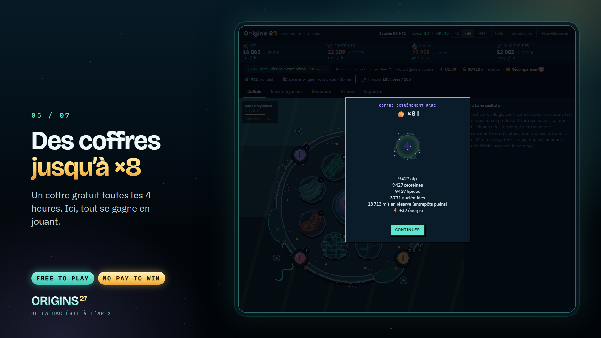
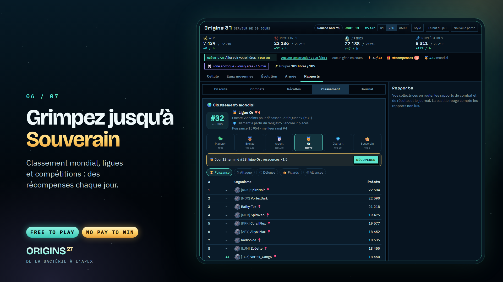

# Origins 27

**Vous naissez bactérie dans un monde hostile. Irez-vous au bout du chemin pour devenir l’APEX légendaire ?**

### ▶ [Jouer maintenant : shakeitout-teach.github.io/origins-27](https://shakeitout-teach.github.io/origins-27/)

*English version available: the game opens in English when your browser isn’t set to French ([play in English](https://shakeitout-teach.github.io/origins-27/?lang=en)).*

**FREE TO PLAY · NO PAY TO WIN** : le jeu est entièrement gratuit, et aucun achat ne donne d’avantage.

Évoluez au détriment de vos rivaux, formez une colonie avec vos alliés, gérez vos troupes et vos ressources : soyez celui qui façonnera le monde de demain… ou pas. Origins 27 est un jeu de stratégie en temps réel, jouable dans le navigateur, sur un serveur de 27 jours peuplé de 500 organismes.

- **Évoluez :** aucune partie ne ressemble à la précédente. Les chemins de l’évolution changent et se tirent au hasard ; réflexion et analyse feront votre domination.
- **Pillez :** 499 autres organismes convoitent votre place. Le meilleur moyen de la garder ? Ne pas leur laisser le choix.
- **Commandez :** vos troupes évoluent au fil des semaines, du rang T1 au légendaire T5. Combinez vos gènes pour forger les meilleures.
- **Dominez :** classement mondial, ligues et compétitions : des récompenses chaque jour pour creuser votre avance.

Le jeu est écrit en HTML, CSS et JavaScript, sans dépendance à installer ni étape de compilation : il suffit d’ouvrir `index.html` dans un navigateur.


## Présentation

- **Bande-annonce (28 s, 1080p) :** [presentation/origins27-bande-annonce.webm](presentation/origins27-bande-annonce.webm)
- **Images légendées :** [paysage 1920 × 1080](presentation/paysage-1920x1080) et [mobile 1080 × 1920](presentation/mobile-1080x1920), plus l’[image clé sans texte](presentation/image-cle-sans-texte.png).

| | |
|---|---|
|  |  |
|  |  |

## Jouer

- **En ligne :** https://shakeitout-teach.github.io/origins-27/ (GitHub Pages, mis à jour automatiquement à chaque modification de la branche `main`).
- **En local :** double-cliquez sur `index.html`.
- **Sur itch.io :** le paquet et la page sont prêts dans [itch/](itch/README.md) (zip fabriqué par `tools/itch-zip.ps1`, couverture, captures en anglais, textes à copier-coller).
- **Sur votre propre copie du dépôt :** *Settings → Pages → Branch : `main` / `(root)` → Save*. Le jeu est ensuite servi à `https://<votre-compte>.github.io/<nom-du-depot>/`.

La partie est sauvegardée dans le navigateur (localStorage), sur l’appareil utilisé.

## Mettre une nouvelle version en ligne

Dans `index.html`, chaque script et la feuille de style portent un numéro de version (`?v=20261123f`). À chaque mise en ligne, changez ce numéro partout (rechercher-remplacer) : sinon le navigateur des joueurs peut garder d’anciens fichiers en mémoire, les mélanger avec les nouveaux, et le jeu ne démarre pas.

## Robot de test (avant chaque lancement)

Trois robots jouent au jeu tout seuls pour trouver les bugs :

- **Le robot « nouveau joueur »** suit le guide des premiers pas comme un joueur appliqué, sur plusieurs parties, et signale toute étape où il reste bloqué.
- **Le robot « singe »** lance des dizaines de parties et clique au hasard sur tout ce qui est cliquable (en privilégiant construire, piller, chasser, donner à l’alliance…), fait filer le temps jusqu’au jour 13, sauvegarde et recharge la partie, et vérifie à chaque pas qu’aucune erreur n’apparaît, qu’aucune ressource ne devient négative, qu’aucun « NaN » ou « undefined » ne s’affiche, que le temps n’avance jamais à l’envers et que la sauvegarde ne perd rien. Chaque bug est noté avec sa graine et les dernières actions, pour être rejoué à l’identique.
- **Le robot « joueur »** (`tools/sim.js`) joue 3 stratégies raisonnables et note les jalons atteints (noyau, stades, APEX) pour suivre l’équilibrage.

**Automatiquement :** sur GitHub, l’action [Robot de test](https://github.com/ShakeItOut-teach/origins-27/actions/workflows/robot.yml) tourne chaque nuit et à chaque mise en ligne, sur ordinateur et sur mobile, dans un vrai navigateur. Le rapport s’affiche dans le résumé de l’action ; GitHub envoie un e-mail si un bug est trouvé. Bouton **Run workflow** pour la lancer à la main avec plus de parties.

**À la main, dans le navigateur** (sur la page du jeu, console F12) :

```js
eval(await (await fetch('tools/monkey.js')).text());
await runGuideBot();                                         // le guide, sur 6 parties
await runMonkey({ games: 20, steps: 400, rich: 3, maxJump: 900 });  // le singe
```

**En local avec Node :** `npm i -D playwright && npx playwright install chromium && node tools/robot-ci.mjs` (écrit `robot-rapport.md`).

La sauvegarde du joueur n’est jamais touchée : les robots travaillent dans une mémoire temporaire.

## Alliances

- **Ouverture au jour 5.** Ce jour-là, l’alliance la plus présente autour du joueur le recrute d’office ; il peut en changer **sans pénalité pendant 24 h** (Rapports → 🤝 Alliance).
- **Technologies d’alliance :** 3 directions (🌱 Croissance, ⚔ Conquête, 🛡 Rempart), 3 technologies chacune, 5 niveaux. Les membres (le joueur et les rivaux de la bannière) y versent des points ; l’alliance suit une technologie **recommandée ⭐** qui rapporte ×1,5. À 600 points de contribution, le joueur devient **Officier** et choisit lui-même la recommandation.
- **Dons :** 20 par jour de jeu ; chacun coûte de l’ATP et des protéines et rapporte de la contribution et des **crédits d’alliance**.
- **Entraide :** « Demander de l’aide » sur un chantier (les membres connectés le raccourcissent, jusqu’à 10 aides) ; « Aider tout le monde » rapporte des crédits.
- **Boutique :** énergie, coffre rare, bouclier d’1 h, construction instantanée.
- **Cadeau d’alliance** chaque jour de jeu, plus gros quand l’alliance monte de niveau.
- **Rivaux plus humains :** chacun dort 10 h d’affilée et se connecte 5 fois par jour ; ils n’attaquent que connectés (statut 🟢 / 💤 / ⚪ sur leur fiche).

## Discord

Collez l’invitation du serveur dans `DISCORD_URL`, en haut de `js/26-alliances.js` (par exemple `"https://discord.gg/xxxxxxx"`). Le bouton « Rejoindre le Discord » apparaît alors dans l’écran Alliance et dans ⚙ Options ; la première visite rapporte +15 ⚡, un coffre rare et 300 crédits d’alliance. Vide, le bouton reste caché.

## Saison de 27 jours, espèce unique et fossiles

Une saison (un serveur) dure **27 jours** de jeu (`SEASON_DAYS` dans `js/01-monde.js`). L’horloge affiche « Jour 6/27 ». Au jour 27, l’espèce du joueur entre au **Muséum** (gardé dans ce navigateur) ; il peut continuer en prolongation ou ouvrir la saison suivante.

- **Mutations visibles** : chaque mutation se dessine sur la cellule (cils, antennes, paroi, poche digestive, plasmides…), et des taches de pigment propres à chaque partie rendent deux cellules toujours différentes.
- **Mon espèce** (bouton dans l’onglet Évolution) : un nom latin qui change avec le stade de vie, un **cousin fossile réel** (18 animaux documentés, de *Charnia* à *Meganeura*, de l’Ediacarien au Carbonifère) et une **planche** à télécharger ou partager (image 1080 × 1350).
- **Fossiles de la saison** : 6 fossiles tirés au sort par saison. Si le cousin fossile du joueur en fait partie, il reçoit un petit bonus (5 à 8 %).
- **Dormance** (⚙ Options) : 8 h par jour, choisies par le joueur (23 h – 7 h par défaut), où personne ne l’attaque. S’il pille pendant ce temps, il perd sa protection jusqu’à la fin de la nuit (après confirmation) ; de même, piller pendant le bouclier d’une heure qui suit un pillage subi le brise pour le reste de l’heure. Modifiable une fois par 24 h.
- **Réflexes** (⚙ Options) : esquive automatique si la défense ne tiendrait pas (activé par défaut), récolte en boucle (désactivée par défaut).
- **Gazette du serveur** (Rapports › Gazette) : les brèves du jour, le top 3, l’alliance en tête, le pillard le plus redouté, le fossile du jour, et un bouton « Copier pour Discord ».

## Identité graphique : le carnet de laboratoire

Le jeu se présente comme le carnet d’un naturaliste : papier quadrillé, encre bleu nuit (`#1D2433`), éosine pour les actions (`#A8402C`), algue pour la vie et les gains (`#3F7D5C`), iode pour les récompenses (`#D9A441`), lame pour l’évolution (`#4A6FA5`). Les titres sont en Instrument Serif, le texte en IBM Plex Sans, les chiffres en IBM Plex Mono. Fiches et boutons ont un contour d’encre et une ombre dure, sans flou.

Les vues vivantes (cellule, carte, écran titre) restent sombres : ce sont les lames observées au microscope, collées dans le carnet avec un cadre d’encre. L’ancien thème sombre « Abysses » reste disponible dans ⚙ Options → Thème. Tout le thème tient dans `css/lab.css`, rangé sous la classe `body.lab`.

## Options, sauvegarde et application

Le bouton **⚙ Options** règle le son et la musique (synthétisés dans le navigateur, aucun fichier audio), les effets visuels, les notifications (chantier fini, attaque, troupes prêtes, quand le jeu est ouvert en arrière-plan) et le style graphique. Il permet aussi d’**exporter la partie** (fichier `.o27` ou code à copier) et de l’**importer** sur un autre appareil. Le jeu s’installe comme une application (`manifest.webmanifest`, `sw.js`) et reste jouable hors ligne une fois chargé. Les 8 dernières erreurs techniques sont gardées sur l’appareil et jointes à « Mon avis ». La page [confidentialite.html](confidentialite.html) explique tout cela aux joueurs.

## Langues

Le jeu existe en **français** et en **anglais**. Il s’ouvre dans la langue du navigateur (français si le navigateur est en français, anglais sinon) ; le bouton **FR / EN** en haut de l’écran, ou **🌐** en bas de l’écran d’accueil, change de langue et garde ce choix. L’adresse peut aussi forcer la langue : `?lang=en` ou `?lang=fr`.

Dans le code, chaque texte s’écrit avec ses deux langues côte à côte : `tr("Construire","Build")`. Pour corriger une traduction, cherchez la phrase française dans `js/` et modifiez le texte anglais juste à côté. Les textes déjà enregistrés dans une partie (journal, rapports) restent dans la langue où ils ont été écrits.

## Avis des joueurs

Le bouton **Mon avis** (✉ sur mobile), en haut de l’écran et en bas de l’écran d’accueil, ouvre une fenêtre de 3 questions et une note sur 5. Le joueur peut :

- **Envoyer sur GitHub :** une page « New issue » s’ouvre déjà remplie, avec en plus le jour, le stade, la souche et l’appareil. Les avis arrivent dans l’onglet [Issues](https://github.com/ShakeItOut-teach/origins-27/issues) du dépôt. Il faut un compte GitHub gratuit.
- **Copier le texte :** pour l’envoyer par message, sans compte.

Le texte tapé est gardé si la fenêtre est fermée. Un seul rappel discret apparaît au jour 2 de la partie.

**Compteur de visites (facultatif) :** créez un compte gratuit sur [goatcounter.com](https://www.goatcounter.com), puis collez son adresse dans `STATS_URL`, en haut de `js/22-avis.js` (par exemple `https://origins27.goatcounter.com/count`). Le comptage est anonyme, sans cookie, et ne fonctionne que sur le site en ligne.

## Contenu détaillé

- **Écran d’accueil :** image animée de l’ascension (procaryote, eucaryote, colonie, pluricellulaire, APEX sortant de l’eau), accroche, « Jouer maintenant » en un clic, et l’histoire en 7 étapes pour qui veut lire.
- **Cellule :** 4 canaux de production (ATP, protéines, lipides, nucléotides) ; chaque canal coûte peu de la ressource qu’il produit et 8 emplacements d’organites autour du noyau.
- **Armée en rangs T1 à T5 :** deux branches, 🔍 récolte et espionnage (collectrice → éclaireuse et porteuse → diatomée de verre → siphonophore → cténophore spectral) et ⚔ attaque (soldate → une troupe par voie offensive → Volvox gardien → Ver segmenté → Anomalocaride). Chaque rang se débloque par une recherche militaire aux coûts et durées exponentiels (2 h, 8 h, 24 h, 48 h de jeu) : T2 vers le jour 3, T3 vers le jour 10, T4 vers le jour 18, T5 dans la dernière semaine. Plus le rang est haut, plus l’icône de la troupe est aboutie : membrane simple, organites, armure, colonie, puis forme légendaire dorée et animée.
- **Espionnage :** les troupes de la branche récolte et espionnage peuvent espionner un rival (⚡1). Réussite selon la force d’espionnage contre sa vigilance ; un succès affiche ses chiffres exacts pendant 24 h, un échec coûte la moitié des espionnes.
- **Production :** les ribosomes fabriquent toutes les troupes, avec une chaîne de production de plus aux niveaux 3, 6 et 9 ; la production se lance aussi depuis le noyau.
- **Envois :** mode « Auto » ou « Je choisis » pour composer soi-même chaque chasse, pillage ou récolte.
- **Rapports :** tableau de force par type de troupe (voie, bonus, pertes), raison de la victoire ou de la défaite, détail du butin et des ressources volées, bilan cumulé des pillages.
- **Énergie (⚡) :** chaque action en consomme (récolter ou explorer 1, chasser 2, piller 3, accélérer un chantier ou un gène de 1 h : 5). Elle remonte de 1 toutes les 20 minutes jusqu’à 30. Seules les récompenses la font dépasser 30 (jusqu’à 120) : connexion du jour, coffres, quêtes du jour, ligue, léviathan vaincu et gisements d’événement (gratuits à récolter, +2 au retour).
- **Récompenses (🎁) :** série de connexion sur 7 jours, coffre gratuit toutes les 4 heures, 3 quêtes du jour. Les coffres ont 4 raretés : commun ×1 (70 %), rare ×2 (20 %), très rare ×4 (8 %), extrêmement rare ×8 (2 %). L’ouverture est animée : le coffre tombe, monte en rareté sous vos yeux (gris → turquoise → violet → or), s’ouvre dans un éclat de lumière, puis les récompenses en sortent une à une (un toucher passe directement au résultat). Rien n’est perdu : ce qui ne rentre pas dans les entrepôts va dans une réserve (🧺), à l’abri du pillage, qui les remplit automatiquement dès qu’il y a de la place.
- **Rythme d’un serveur de 27 jours :** production passive réduite de 30 %, coûts qui montent avec les niveaux, capacité des entrepôts ajustée en conséquence. En simulation, un joueur qui ouvre ses coffres atteint l’APEX vers le jour 20 ; sans coffres, il n’y arrive pas en 27 jours.
- **File de constructions :** jusqu’à 2 constructions programmées derrière celle en cours, annulables avec remboursement.
- **Attaques subies :** tant qu’un rival est en route, les bords de l’écran scintillent en rouge (plus vite dans le dernier quart d’heure). Pour chaque attaque, vous choisissez : 🛡 **Défendre** (vos troupes au repos se battent ; quelques-unes tombent si la défense tient, la moitié si elle cède) ou 💨 **Esquiver** (elles quittent la cellule sans perte, mais ne défendent pas). Le choix est expliqué à la première attaque.
- **Protections (en heure réelle, quelle que soit la vitesse du jeu) :** après un pillage subi, 🛡 une heure pendant laquelle aucun rival ne peut vous attaquer (elle s’arrête si vous pillez quelqu’un) ; et 🌙 de minuit à 7 h, personne n’attaque personne, même pendant le rattrapage hors ligne. Les attaques déjà en route font demi-tour.
- **Riposte :** chaque pillage subi propose « Riposter » ; dans les 24 h de jeu, la vengeance rapporte +50 % de butin. Les ennemis jurés sont listés dans le Classement.
- **Classement mondial :** votre rang parmi les 500 organismes du monde en 5 catégories (puissance, attaque, défense, pillards, alliances), avec la progression ▲▼ depuis le début du jour. 6 ligues (Plancton → Souverain) donnent une récompense à chaque fin de jour de jeu. Une ligne dont la position est connue s’ouvre sur la carte.
- **Retour de pause :** une seule fenêtre « Pendant votre absence » résume tout, au lieu d’une fenêtre par événement.
- **Évolution :** arbre de gènes à 3 branches, 5 voies offensives en cycle, émergences cachées, et une mutation à choisir parmi 3 à chaque niveau de noyau (3 de la même famille ouvrent une lignée).
- **Stades de vie :** Procaryote → Eucaryote → Colonie → Pluricellulaire → APEX (victoire : sortir de l’eau).
- **Monde :** carte circulaire de 241 × 241 cases, événements de zone (éruption, plancton, zone anoxique, léviathan), 499 rivaux simulés qui s’adaptent à vos choix, 6 alliances.
- **Mobile :** navigation en bas d’écran, zoom à deux doigts sur la carte, récolte automatique (⛏), conseiller « que faire ? ».

## Organisation du code

```
index.html          la page : en-tête, zones de l’écran, et la liste des scripts à charger
css/style.css       toute l’apparence (couleurs, mise en page, animations)
css/lab.css         le thème « Carnet de laboratoire » (par défaut) : papier, encre, éosine ; sans lui, le thème sombre « Abysses »
js/00-langue.js … js/27-saison.js   le jeu, découpé par thème (00 : la langue, chargée en premier ; 23 : le guide des premiers pas ; 24 : les missions d’apprentissage ; 25 : les options ; 26 : les alliances)
apercu.jpg          l’image affichée quand on partage le lien (1200 × 630)
```

Les scripts sont des fichiers JavaScript classiques, chargés **dans l’ordre de leur numéro** et qui partagent les mêmes variables globales (l’état de la partie s’appelle `S`). Pas de module ni de compilation : c’est ce qui permet au jeu de s’ouvrir d’un double-clic, sur GitHub Pages comme en local. Chaque fichier commence par une ligne qui résume son contenu.

**Où modifier quoi :**

| Je veux changer… | Fichier |
|---|---|
| Les couleurs, la mise en page, une animation | `css/style.css` |
| Le thème Carnet de laboratoire (papier, encre) | `css/lab.css` |
| Le choix de la langue, les petits outils de traduction | `js/00-langue.js` |
| Le monde, les zones, la taille de la carte | `js/01-monde.js` |
| Les ressources, souches, canaux, organites, gènes | `js/03-regles.js` |
| Les mutations et lignées | `js/04-mutations.js` |
| Les troupes, leurs coûts, les rangs T1 à T5 | `js/05-troupes.js` |
| La production, l’entretien, les coûts des constructions | `js/07-economie.js` |
| L’énergie, la connexion quotidienne, les coffres, les quêtes du jour | `js/08-recompenses.js` |
| Les rivaux, les attaques subies, les protections (nuit, bouclier) | `js/09-rivaux.js` |
| Le classement mondial et les ligues | `js/10-classement.js` |
| La boucle de simulation, les constructions, les envois | `js/11-moteur.js` |
| Les événements de zone et les alliances | `js/12-evenements.js` |
| Ce que fait un bouton (`data-act="…"`) | `js/13-actions.js` |
| L’affichage des onglets, les quêtes, le conseiller | `js/14-interface.js` |
| Les rapports, le héros, l’onglet Armée | `js/15-panneaux.js` |
| Les fiches de détail et les fenêtres | `js/17-fiches.js` |
| L’écran titre, l’introduction, la visite guidée | `js/18-accueil.js` |
| La carte | `js/19-carte.js` |
| La sauvegarde, le démarrage | `js/21-demarrage.js` |
| La fenêtre « Mon avis », le compteur de visites | `js/22-avis.js` |
| Le guide des premiers pas (étapes, textes, flèche, temps accéléré), le pillage d’entraînement contre la souche-miroir, le coffre doré | `js/23-premiers-pas.js` |
| Les missions d’apprentissage (📘) : liste, textes, récompenses | `js/24-apprentissage.js` |
| Le son, la musique, les effets visuels, les notifications, l’export/import de la sauvegarde, la fenêtre ⚙ Options | `js/25-options.js` |
| Les alliances (technologies, dons, entraide, boutique, cadeau), le lien Discord | `js/26-alliances.js` |
| La saison de 27 jours, la dormance, les réflexes, les mutations visibles, les fossiles, la planche d’espèce, la Gazette | `js/27-saison.js` |
| Le rythme de vie des rivaux (sommeil, connexions) | `js/09-rivaux.js` |

Pour ajouter un fichier : créez-le dans `js/`, en commençant par `"use strict";`, puis ajoutez sa ligne `<script src="js/…"></script>` dans `index.html`, après les fichiers dont il utilise les fonctions au chargement.

## Outils

`tools/monkey.js` et `tools/robot-ci.mjs` : voir « Robot de test » plus haut.

`tools/sim.js` est un robot de test qui joue des parties accélérées pour vérifier l’équilibrage. Il se charge dans la console du navigateur, sur la page du jeu :

```js
eval(await (await fetch('tools/sim.js')).text());
runSim({ souche: 'kori', days: 8, maxCells: 14, auto: true, army: true, migrate: true });
```

Il s’appuie sur l’objet de débogage `window.__o27` exposé par le jeu.
